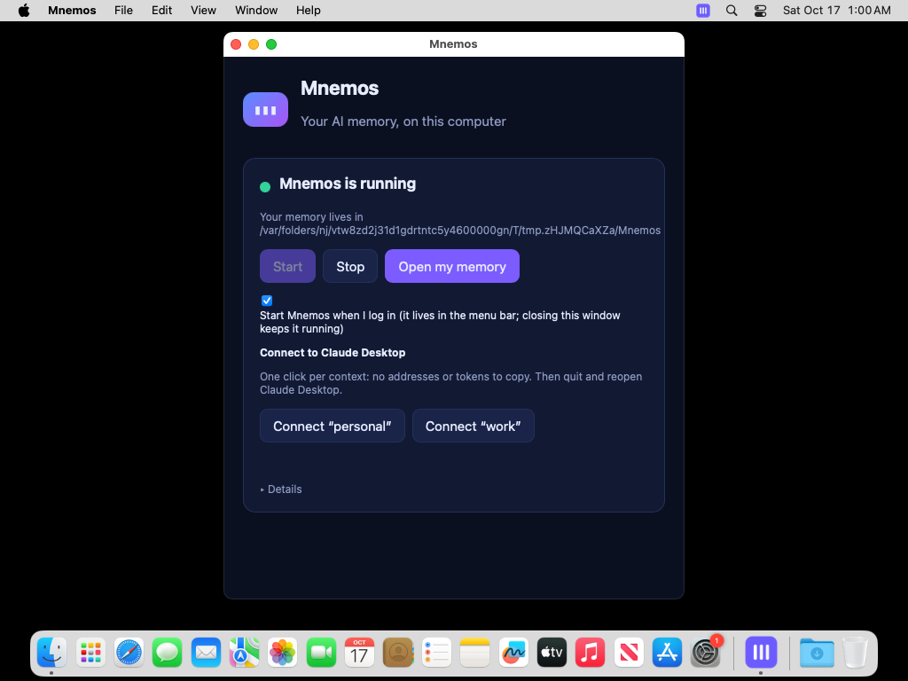

# Install Mnemos on a Mac (5 minutes, no technical skills)

Mnemos gives your AI apps (Claude, ChatGPT, Cursor) one memory that you own. Everything stays on your Mac.
*Versión en español más abajo.*

## 1. Download
Download **[Mnemos-macos.dmg](https://github.com/ngentile92/mnemos/releases/latest/download/Mnemos-macos.dmg)**,
open it and drag **Mnemos** into **Applications**.

## 2. Open it the first time (important)
The app is not signed by Apple yet, so a normal double-click shows *"cannot be opened"*. Do this once:
1. Open **Applications**, **right-click** (or Control-click) **Mnemos** → **Open**.
2. Click **Open** again in the warning.

From then on it opens normally. If you only see *"Move to Trash"*: go to **System Settings → Privacy & Security**,
scroll down and click **Open Anyway** next to Mnemos.

## 3. Set it up
The first screen asks for your name and your "contexts" (separate memories, e.g. `personal` and `work`). Keep the
defaults if unsure, then click **Create**.

When it is ready you see a green **Mnemos is running**, and the Mnemos icon appears in the menu bar (top right):

## 4. Connect Claude Desktop
Click **Connect Claude Desktop** (one entry for all your spaces). Then quit Claude completely (**Cmd+Q**) and open
it again. If you installed an older Mnemos extension (`.mcpb`) in Claude, remove it in **Settings → Extensions** so
Claude does not see two Mnemos.
Ask Claude *"what do you know about me?"* — it now reads and saves to Mnemos on its own.

## 5. See and fix your memory
Click **Open my memory**: search notes, edit, pin, mark as outdated, forget (with undo), see the graph of people
and projects, edit your skills, and **Import** what ChatGPT or Claude already know about you.

### Scan this Mac (first big import)
The first time your memory is empty, Mnemos offers to **Scan this Mac** (also under **Import**). It looks, read-only,
for what you already told other AIs: Claude Code sessions (`~/.claude/projects`), `CLAUDE.md` / `AGENTS.md` files,
Cursor chats and rules, Obsidian vaults, and ChatGPT / Claude.ai export zips in `Downloads`. You see "Found N
sources", pick which ones and which context each goes to, and get a full preview of the facts found. Nothing is
saved until you click **Save**, and **Undo this import** removes the whole batch. Anything that looks like a
password, token or key is dropped, and `.env` files are never opened. With the built-in model (or Ollama, or an API key you
enabled) facts are picked better; otherwise simple rules are used. For memories that live only in the cloud, the
**Claude.ai / ChatGPT** buttons copy a prompt, open the site, and give you a box to paste the answer.

### Improve my memory (built-in model, optional)
The first time you open your memory, Mnemos offers to **download a small private AI model** (about 1.4 GB, once).
It runs on your Mac (Apple Silicon uses the GPU), nothing is sent anywhere, and it makes import find better facts,
spots duplicates written with different words, and catches notes that disagree. Click **Not now** and Mnemos keeps
working with simple rules; you can download it later in **Settings → Improve my memory**. The download resumes if
it is interrupted and is checked before use. If you run [Ollama](https://ollama.com), Mnemos uses it first.
**Settings** also accepts an OpenAI or Anthropic API key (kept in the Keychain) for import and/or cleanup only:
then that text is sent to the provider. The **Engine** badge at the top shows what is in use: Rules, Built-in,
Ollama or API.

**Good to know:** addresses ending in `/mcp` are for AI apps, not for your browser. Your data lives in the
`Mnemos` folder in your home folder; back it up like any other folder.

## Troubleshooting

| What you see | What to do |
|---|---|
| *"Mnemos cannot be opened because the developer cannot be verified"* | Right-click → **Open** (step 2). Or **System Settings → Privacy & Security → Open Anyway**. |
| *"Mnemos is damaged and can't be opened"* | The download was quarantined. In Terminal: `xattr -cr /Applications/Mnemos.app`, then open it again. |
| A box asks for access to the **Keychain** | Click **Always Allow**: Mnemos keeps its private key there. It can ask again after an update. |
| *"port 8765 is already in use"* | Another Mnemos is running. Quit it from the menu bar icon (**Quit Mnemos**) and open it again. |
| Claude does not use Mnemos | Quit Claude with **Cmd+Q** (closing the window is not enough) and reopen. If you moved Mnemos.app after connecting, click **Connect** again. |
| Claude shows Mnemos twice | You also installed the `.mcpb` extension. Keep one: remove it in Claude → **Settings → Extensions**. |
| A page says *"This address is for AI apps"* | Normal: `/mcp` addresses are for Claude, not your browser. Use **Open my memory**. |
| The memory page asks for a password | Open it from the app or the menu bar (**Open my memory**), or type the password you chose at setup. |
| I want to start over | Quit Mnemos, delete the `Mnemos` folder in your home folder, open the app again. This erases your memory. |

Logs: `~/Mnemos/hub.log`. Report problems at https://github.com/ngentile92/mnemos/issues.

---

# Instalar Mnemos en una Mac (español)

1. **Descargá** [Mnemos-macos.dmg](https://github.com/ngentile92/mnemos/releases/latest/download/Mnemos-macos.dmg),
   abrilo y arrastrá **Mnemos** a **Aplicaciones**.
2. **La primera vez:** en Aplicaciones, **clic derecho** sobre Mnemos → **Abrir** → **Abrir**. (La app todavía no
   está firmada por Apple.) Si solo aparece "Mover a la papelera": **Ajustes del Sistema → Privacidad y
   seguridad → Abrir igualmente**.
3. **Configuralo:** poné tu nombre y tus contextos (por ejemplo `personal` y `trabajo`) y tocá **Create**.
4. **Conectá Claude Desktop:** tocá **Connect Claude Desktop** (una sola entrada para todos tus espacios), cerrá
   Claude con **Cmd+Q** y abrilo de nuevo. Si tenías la extensión vieja (`.mcpb`), sacala en **Settings → Extensions**.
   Preguntale "¿qué sabés de mí?".
5. **Mirá y corregí tu memoria:** **Open my memory** → notas, grafo, skills e **Import** (traer lo que ya saben
   ChatGPT o Claude).

**Si algo falla:** "no se puede abrir" → clic derecho → Abrir · "está dañada" → en Terminal
`xattr -cr /Applications/Mnemos.app` · te pide el Llavero → "Permitir siempre" · Claude no lo usa → Cmd+Q a Claude y
abrilo de nuevo. Más casos en la tabla *Troubleshooting* de arriba.
